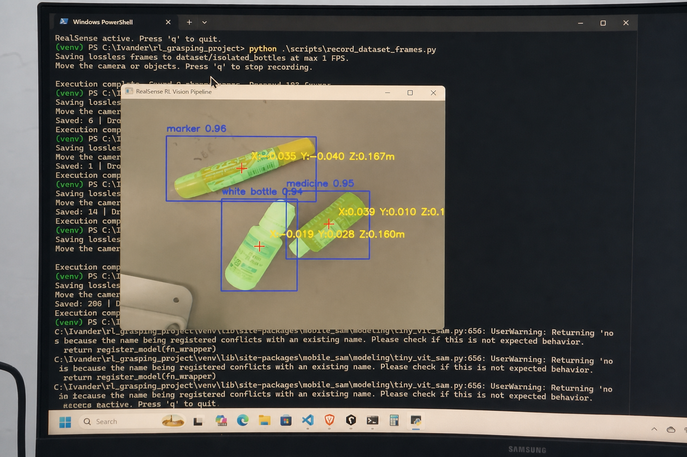

# RT-DETR + MobileSAM Vision Pipeline

A real-time object perception pipeline that combines RT-DETR object detection, MobileSAM instance segmentation, and Intel RealSense depth data.

The system detects objects in a color frame, uses each detection as a prompt for MobileSAM, and estimates the segmented object's 3D position from the aligned depth frame. Results are displayed with bounding boxes, segmentation masks, class labels, confidence scores, and camera-frame coordinates.

This project was developed as part of my undergraduate research project at the **Advanced Robotics and AI Lab, Yuan Ze University**. The perception system is designed to identify objects in cluttered tabletop environments and extract their spatial coordinates for downstream robotic manipulation.

<p align="center">
  
  <br>
  <sub><em>Note: The project initially used a white-bottle class, which was later replaced with a glue class during dataset refinement.</em></sub>
</p>

## Pipeline

```text
RealSense color + depth frames
            |
            v
     RT-DETR detection
       (class + box)
            |
            v
 MobileSAM segmentation
       (object mask)
            |
            v
 Mask centroid + depth sampling
            |
            v
 Camera-frame XYZ coordinates
            |
            v
    OpenCV visualization
```

## Main Features

- Real-time object detection with RT-DETR
- Bounding-box-prompted segmentation with MobileSAM
- Aligned color and depth capture from an Intel RealSense camera
- Median depth sampling around each mask centroid
- 2D pixel-to-3D camera coordinate deprojection
- Per-class visualization with boxes, masks, labels, and XYZ values
- Utilities for recording, extracting, splitting, and cleaning image datasets
- Training notebooks for RT-DETR and YOLO experiments

## Dataset

A custom dataset was created for tabletop robotic manipulation experiments.

- **Total images:** 7,864
- **Classes:** 3
  - Marker
  - Medicine
  - Glue
- **Input resolution:** 640 × 640

Images were collected under different object positions, backgrounds, lighting conditions, clutter levels, and partial occlusions.

The dataset was annotated and augmented using Roboflow to improve robustness to variations in the operating environment.

The final augmented dataset was split as follows:

| Split | Percentage | Images |
| --- | ---: | ---: |
| Train | 88% | 6,882 |
| Validation | 8% | 655 |
| Test | 4% | 327 |

Roboflow preprocessing and augmentation settings:

- **Auto-Orient:** Applied
- **Resize:** Stretched to 640 × 640
- **Outputs per training example:** 3
- **90° rotation:** Clockwise, counter-clockwise, and upside down
- **Rotation:** Between −15° and +15°
- **Brightness:** Between −17% and +17%
- **Exposure:** Between −15% and +15%

## Results

The RT-DETR-L model was trained for 100 epochs, with the best checkpoint selected at epoch 96 based on validation mAP@50:95.

On the final test set of 327 images and 1,040 annotated objects, the model achieved:

| Class | Precision | Recall | mAP@50 | mAP@50:95 |
|---|---:|---:|---:|---:|
| Overall | 0.980 | 0.974 | 0.980 | 0.913 |
| Glue | 0.969 | 0.969 | 0.973 | 0.893 |
| Marker | 0.986 | 0.970 | 0.985 | 0.922 |
| Medicine | 0.984 | 0.982 | 0.981 | 0.925 |

The best overall F1-score was **0.9716** at a confidence threshold of approximately **0.789**.

MobileSAM was used as a pretrained segmentation model without additional fine-tuning.

### Observed Limitations

Despite the strong evaluation scores, I observed that the detector could still fail in more difficult real-world scenes, especially when objects were partially occluded or surrounded by clutter.

This was one of the main gaps between the reported evaluation metrics and actual tabletop testing, and it motivated further dataset refinement and more challenging test cases.

## Repository Structure

```text
.
├── notebooks/
│   ├── rtdetr1_trainmodels.ipynb   # RT-DETR training experiments
│   └── yolo26_trainmodels.ipynb    # YOLO training experiments
├── scripts/
│   ├── run_vision_test.py          # Modular live vision entry point
│   ├── record_dataset_frames.py    # Capture sharp RealSense color frames
│   ├── extract_frames.py           # Extract frames from recorded video
│   ├── coco_split.py               # Create train/validation/test COCO splits
│   └── clean_dataset.py            # Remove near-duplicate labeled scenes
├── src/
│   ├── hardware/realsense.py       # RealSense capture and depth alignment
│   └── perception/vision.py        # Detection, segmentation, and 3D extraction
├── .env.example                    # Local model-path configuration example
└── requirements.txt                # Python dependencies
```

## Requirements

- Python 3.9 or newer
- Intel RealSense camera with color and depth streams
- RT-DETR `.pt` weights trained for the target objects
- MobileSAM `mobile_sam.pt` checkpoint
- CUDA-capable GPU recommended for real-time inference

The model checkpoints and datasets are local assets and are not included in the repository.

## Setup

Create and activate a virtual environment:

```bash
python3 -m venv .venv
source .venv/bin/activate
```

Install the dependencies:

```bash
pip install -r requirements.txt
```

Copy the environment example and set the paths to your checkpoints:

```bash
cp .env.example .env
```

```dotenv
DETR_WEIGHTS=/path/to/your/detr_weights.pt
SAM_WEIGHTS=/path/to/your/mobile_sam.pt
```

Both model paths must be supplied through command-line arguments, the shell environment, or `.env`. Command-line arguments override environment values. The code intentionally does not select a checkpoint automatically because checkpoints can use different class schemas.

## Current Scope and Limitations

- Live operation requires compatible RealSense hardware and working `pyrealsense2` support.
- Checkpoints must match the object classes expected by the application.
- The reported 3D position represents the segmented object's mask centroid, not a grasp pose.
- Depth accuracy depends on valid aligned depth at the selected centroid.
- Camera-frame coordinates require a separate calibrated transform before they can be used in another coordinate system.
